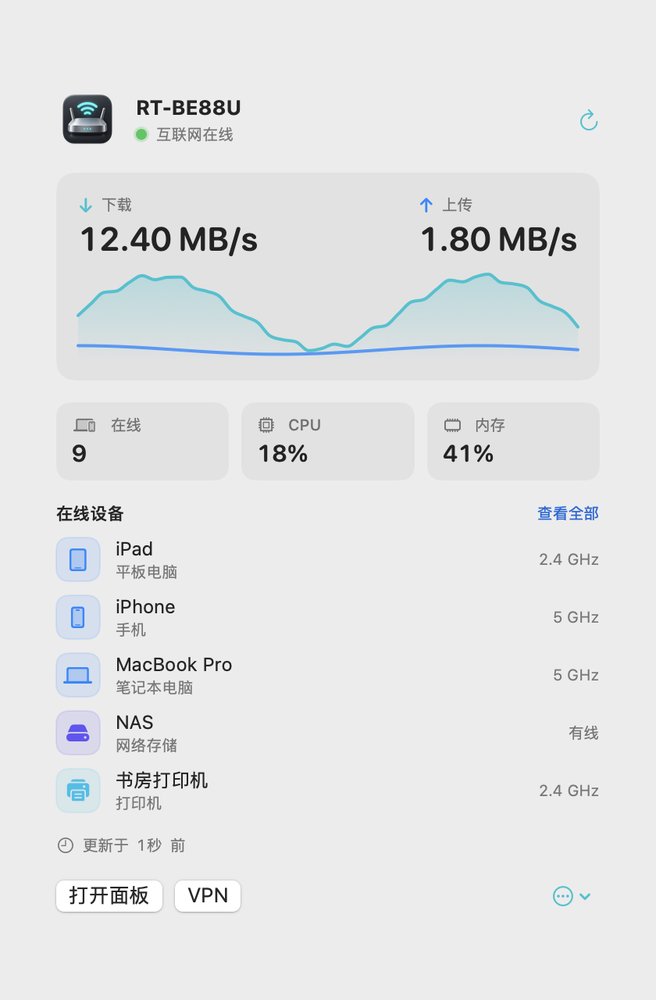
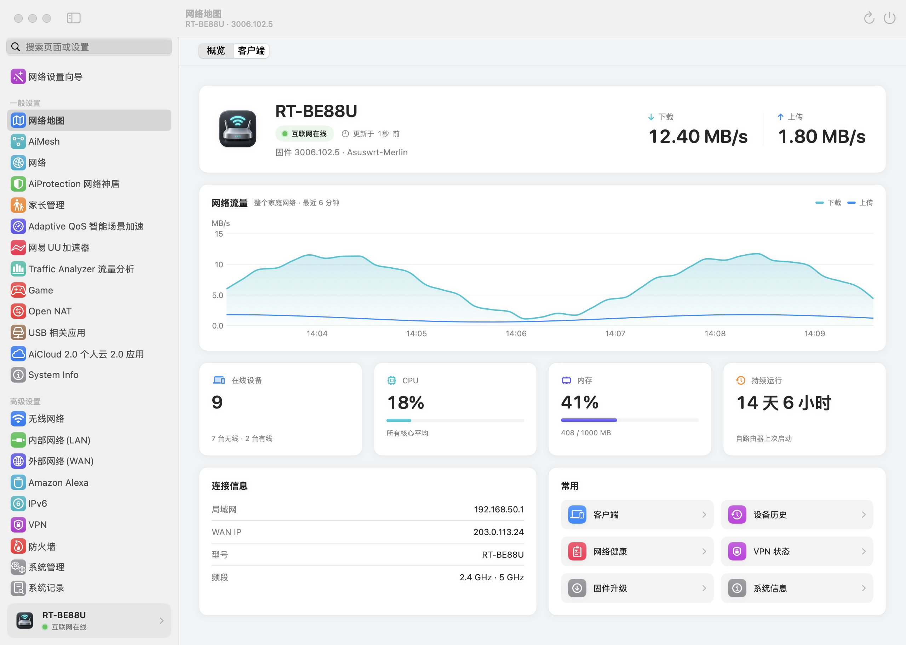
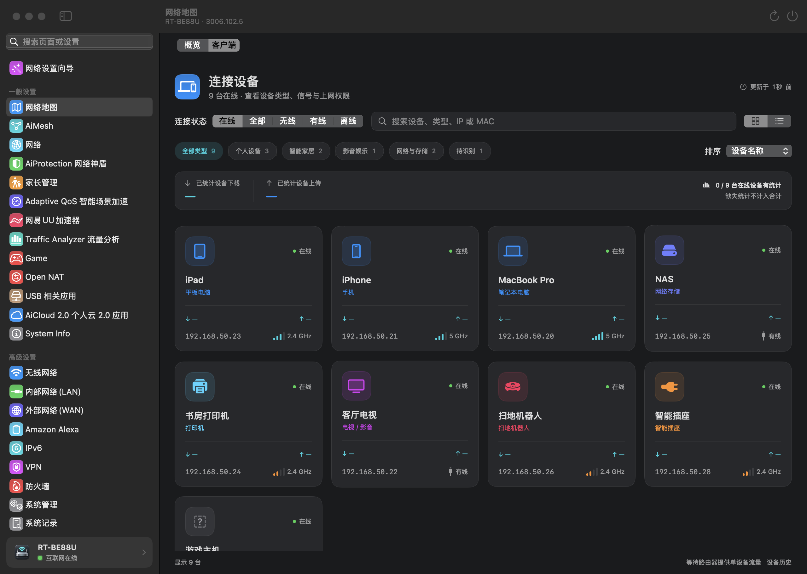
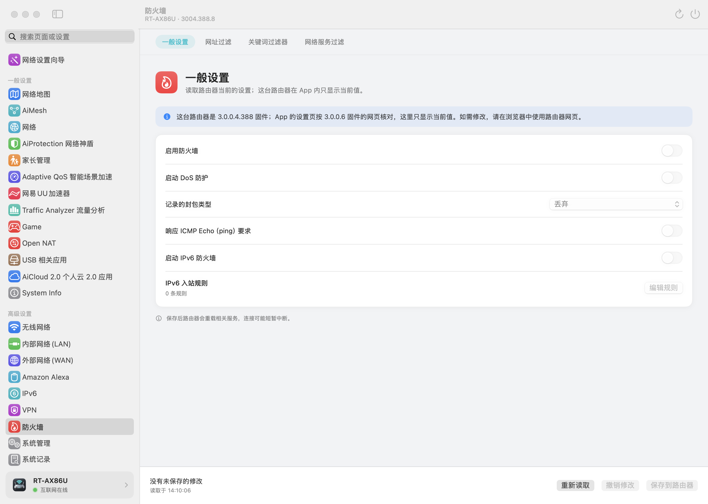

# 路由器面板 RouterBar

简体中文 | [English](README.en.md)

华硕路由器的原生 macOS 菜单栏 app，非官方第三方工具。支持原厂固件和 Asuswrt-Merlin：连上哪台路由器，侧栏就按那台路由器自己的网页菜单生成，名称和顺序与网页相同。所有页面都用 SwiftUI / AppKit 原生实现，不嵌入网页。

- **菜单栏**：互联网状态、全路由器上下行速度、在线设备、CPU 和内存。
- **设备**：21 种设备类别、卡片和列表、单设备实际流量、设备历史与离线提醒。
- **设置**：与网页分页一一对应的原生设置页，字段类型和范围按固件网页的校验规则核对；保存前列出改动，保存后读回核对。
- **只读兜底**：没有核对过的固件只读；会改动路由器的每一步都要你确认。

> **验证范围**：实机只在 RT-BE88U（Asuswrt-Merlin 3006.102.5）上做过只读验收。写入功能只在模拟路由器上测试过，还没有在真实路由器上执行。其他机型靠读取路由器自己的菜单和固件信息来适配，没有逐台实机测试。

## 截图









截图用 App 内置的示例数据渲染，不是真实网络。

## 适配哪些路由器

连接后，App 先读型号、固件分支、原厂还是 Merlin 以及各频段，再把路由器自己下发的 `state.js` 和 `menuTree.js` 放进一个可随时结束的子进程，用 JavaScriptCore 运行（脚本拿不到网络、文件和 DOM；超过 4 秒、1 MB 输出或 512 MB 内存就结束），按网页的 `showMenuTree` 规则算出这台路由器实际显示的菜单、分页和名称。网页按机型或当前设置隐藏的分页，App 也隐藏。菜单和机型缓存在本机，下次启动先按上次的结果显示。

能否写入按固件分级：

| 固件 | 写入 |
| --- | --- |
| 3.0.0.6.102（3006） | 设置页和功能页可以保存；无线专业设置只在 RT-BE88U 上可保存 |
| 3.0.0.4 的 384 / 386 / 388 | 设置页只显示当前值；只保留各分支相同的五项维护：固件上传、配置恢复、恢复出厂、重启、网络诊断 |
| 更早或识别不出的版本 | 完全只读 |

本次连接识别出型号和固件、读到路由器菜单之前，App 不发出任何修改；刷完固件后重新识别，再开放写入。三频、四频路由器的无线设置按实际频段分页。

## 功能

- **概览与菜单栏**：互联网状态、全路由器上下行流量、设备数、CPU、内存、运行时间。流量是路由器 INTERNET 计数器的差值，不是这台 Mac 的速度。
- **连接设备**：按类别筛选和搜索，卡片、列表两种视图；设备详情可以改名、暂停或恢复上网。
- **设备历史与离线提醒**：记录 App 运行期间看到的上下线，保留最近 30 天；关注的设备连续离线 3 分钟后发通知。
- **网络健康**：WAN 状态、路由器到外网的 Ping 和域名解析、弱信号、内存、存储和温度。只显示证据，不自动改设置。
- **Wi-Fi 与网络**：SSID、安全方式、访客网络、隔离、Wi-Fi 7 模式联动。无线安全按 3006 网页规则整组核对：WPA3 必须启用受保护的管理帧，6 GHz 只允许 WPA3。
- **设置**：59 个分区、650 个字段，覆盖无线、LAN / DHCP、WAN / DNS、IPv6、端口转发、路由、防火墙、VPN、QoS 和系统设置；时区与夏令时用原生选择器。
- **VPN**：OpenVPN 客户端和服务器、WireGuard、PPTP / L2TP 与 VPN Fusion。
- **其他原生页面**：AiMesh 节点、AiCloud、Open NAT、游戏加速、双线路、家长管理、AiDisk、网络设置向导等。
- **固件与维护**：检查并下载 Asuswrt-Merlin 正式版，或选择本地固件文件；SHA-256 校验、上传进度、等待重启和版本回读。配置备份与恢复、重启。
- **只读信息**：系统信息、流量监控、AiProtection 记录、Traffic Analyzer、系统日志、DHCP 租约、路由表、连接记录。
- **网络工具**：路由器端的 Ping、Traceroute、DNS 查询和 Netstat。

## 使用

1. 构建并安装（见下文“构建”），打开 `~/Applications/RouterBar.app`。App 常驻菜单栏，关掉主窗口也不退出。
2. 在“连接设置”里填路由器地址（例如 `http://192.168.50.1`）和管理员账号。macOS 15 起，首次连接时系统会询问本地网络权限，需要允许。
3. 勾选保存密码后，下次用钥匙串自动登录。

HTTPS 地址使用系统证书验证；路由器的自签证书不受信任时，请改用局域网内的 HTTP 地址。

## 改设置时会发生什么

编辑不会立刻改到路由器。点保存后，App 先重新读取当前值，再列出会写入的变量和影响；提交后再读回比较，一致才显示“已确认保存”。固件上传、重启、恢复和删除会另外说明具体影响。

请求发出后连接中断，或路由器回应 5xx、无法识别的内容时，显示“结果尚未确认”并提示重新读取核对，不当作失败，也不自动重发。需要重启的操作等路由器恢复后再核对。写入互斥，进行中会暂停常规轮询。

## 数据与隐私

- App 只连接你填写的路由器。另外只在你打开对应功能时访问两处公开地址：检查或下载 Merlin 固件时访问 SourceForge（独立、无 Cookie 的 HTTPS 会话，不带路由器账号）；打开 Open NAT 页时从华硕服务器取游戏列表，路由器网页也是从那里取的。你手动运行网络健康检查时，由路由器自己 Ping 1.1.1.1 并解析 example.com。
- 没有统计、遥测或崩溃上报。
- 密码只在你选择保存时写入 macOS 钥匙串。登录 Cookie 只放在独立的临时会话里，不读取浏览器的 Cookie。
- 设备历史只保存在本机 `~/Library/Application Support/com.yihang.RouterBar/DeviceHistory`（目录权限 0700、文件 0600），不含密码和 Cookie。

## 构建

需要 macOS 14 或更新。`Package.swift` 要求 Swift 6.0 工具链；目前在 Xcode 27.1（Swift 6.4）上构建和测试。没有第三方依赖。

```sh
./script/test.sh                        # 运行测试
./script/build_and_run.sh               # 构建、安装到 ~/Applications/RouterBar.app 并打开
./script/build_and_run.sh --build-only  # 只构建
```

构建缓存放在 `~/Library/Caches/com.yihang.RouterBar/`，安装包另存一份 `dist/RouterBar.zip`。签名自动选用钥匙串里的 Apple Development 证书（可用 `CODESIGN_IDENTITY` 指定）；没有证书时用 ad hoc 签名，这时每次更新后钥匙串会重新询问。没有做 Apple 公证，也不提供预编译安装包。

## 已知限制

- 还没有覆盖路由器网页的全部功能：门户认证、复杂的端口 / VLAN 绑定联动、全部 AiMesh 配对和回程选项、OpenVPN 全部账号及自定义指令、USB 账号与文件夹权限、AiCloud 第三方绑定等尚未完整适配。遇到不兼容的复合规则时，停止该项保存并保留原值。
- 网络设置向导里 DSL、4G / 5G、AiMesh 组网、中继 / 桥接扫描等分支和出厂状态，会在浏览器打开网页向导。
- App 没运行或 Mac 睡眠时不记录设备历史，事后也不补猜。
- 界面只有简体中文。

## 代码结构

- `Sources/RouterCore`：路由器协议、解析、菜单计算、写入门禁和设置目录，不依赖界面。
- `Sources/RouterBar`：SwiftUI / AppKit 界面与状态。
- `Tests/RouterCoreTests`：561 个测试，包括模拟路由器上的写入流程。设置 `ROUTERBAR_HELPER` 为构建出的 `RouterBar` 可执行文件后，会额外运行真实子进程的限制测试。
- `script/`：构建、测试和资源生成脚本。

## 第三方内容

- `Sources/RouterCore/Resources/` 里的 `PolicyTexts.json`、`TimeZones.json`、`SettingsCatalog.json` 由 Asuswrt-Merlin 3006.102.5 的网页文件（`CN.dict`、`Advanced_System_Content.asp`、`ajax/tz_db.json` 等）和路由器网页生成，只含表单结构和界面文字，不含任何路由器的当前设置。其中的条款和界面文字版权属于 ASUSTeK Computer Inc.，收录它们是为了在 App 里显示与路由器网页相同的内容。生成脚本在 `script/`。
- `HTMLEntities.json` 是 WHATWG HTML 标准的命名字符引用表。
- 应用图标由 AI 生成，提示词见 `Assets/ICON-PROMPT.md`。

ASUS、Asuswrt、AiMesh、AiProtection、AiCloud 是 ASUSTeK Computer Inc. 的商标。本项目与华硕没有关联，也未获华硕认可。

## 许可证

[GPL-2.0-only](LICENSE)。部分校验逻辑照 Asuswrt-Merlin 的网页脚本移植，Asuswrt-Merlin 的源码按 GPL v2 发布，所以本项目同样采用 GPL v2。
